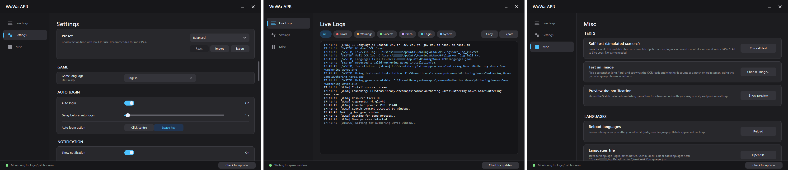

<div align="center">


#### It automatically restarts the game after a patch, because the game itself doesn't.
[](../../releases)
[](../../releases)
[](#get-started)
[](LICENSE)

[Download](../../releases) · [Report a bug](../../issues) · [Build it yourself](DEVELOPMENT.md)



</div>

## What it does

Use WuWa APR as your game shortcut. It launches the game, reads the screen with Windows OCR, and handles the rest:

- **Patch screen?** Closes the game and starts it again. A small notification box shows while it restarts.
- **Login screen?** Stops there, so you can log in yourself (or auto-login, up to you).
- **Already in game?** Detects your UID on screen and closes itself.

## Get started

**You need:** Windows 10 (1809 or newer) or 11, 64-bit, and the Windows OCR pack for your game language
(English is usually already installed, see [Install OCR packs](#install-ocr-packs)).

1. Download `wuwa-apr.exe` from [Releases](../../releases).
2. Run it (it asks for admin) and pick your game install if it asks. It launches the game and does the rest.
3. From now on, start the game through `wuwa-apr.exe` (pin it or make a desktop shortcut) instead of the game's own
   shortcut.

It sits in the tray with a menu: **Status**, **Show UI** and **Quit**. Quitting the app does not close the game.

## Supported languages

Set yours in **Settings > Game language**. Each language needs its Windows OCR pack installed.

| Language | OCR pack | Login | Patch | UID |
| - | - | - | - | - |
| English | `en-US` | ✔ | ✔ | ✔ |
| French | `fr-FR` | ✔ | ❌ | ✔ |
| German | `de-DE` | ✔ | ❌ | ✔ |
| Spanish | `es-ES` | ✔ | ❌ | ✔ |
| Portuguese | `pt-BR` | ✔ | ❌ | ✔ |
| Japanese | `ja-JP` | ✔ | ❌ | ✔ |
| Korean | `ko-KR` | ✔ | ❌ | ✔ |
| Chinese (Simplified) | `zh-CN` | ✔ | ❌ | ✔ |
| Chinese (Traditional) | `zh-TW` | ✔ | ❌ | ✔ |
| Thai | `th-TH` | ✔ | ❌ | ✔ |

> ⚠ Login and UID detection work in all languages, but **patch detection only works in English** for now
> (see the [Roadmap](#roadmap)).

<a id="install-ocr-packs"></a>
<details>
<summary><b>Install OCR packs</b> (check what you have and add your language)</summary>

<br>

APR reads the screen with the OCR built into Windows, so your game language needs its OCR pack.
**Settings** in the app shows a **green** dot next to a language that is ready and a **red** one if its pack is
missing.

**Option 1: Windows Settings (no commands)**

1. Open **Settings > Time & language > Language & region** (Windows 10: **Language**).
2. Click **Add a language** and pick yours.
3. Keep **Optical character recognition** ticked. You can untick the other options, you don't have to change your
   display language.
4. Restart WuWa APR.

**Option 2: PowerShell** (right-click Start > **Terminal (Admin)** or **Windows PowerShell (Admin)**)

Check what is installed (`Installed` means ready, `NotPresent` means missing):

```powershell
Get-WindowsCapability -Online -Name "Language.OCR*" | Select-Object Name, State
```

Install one language (use the code from the table above, here Japanese):

```powershell
Add-WindowsCapability -Online -Name "Language.OCR~~~ja-JP~0.0.1.0"
```

Or install all ten at once:

```powershell
'en-US','fr-FR','de-DE','es-ES','pt-BR','ja-JP','ko-KR','zh-CN','zh-TW','th-TH' | ForEach-Object {
    Add-WindowsCapability -Online -Name "Language.OCR~~~$_~0.0.1.0"
}
```

Then restart WuWa APR.

Windows downloads the packs from Windows Update, so you need to be online and updates must not be blocked.

</details>

## The window

- **Live Logs:** what APR is doing right now. Select text, copy it, export it, or filter by colour.
- **Settings:** presets, scan and startup values, Auto Login, the notification box, and Debugging options. Hover a
  setting for an explanation. Settings can be imported and exported.
- **Misc:** tools to test detection without waiting for a real patch (self-test, test an image), reload
  languages, forget the saved game install, and open your data folder.

The dot in the footer shows the state: **green** is running normally, **blue** is finished (APR is waiting for you
to close the window), **red** is an error.

## Good to know

- **Presets:**
  - **Eco:** slower reaction to screen updates, lowest CPU load.
  - **Balanced:** a balance between recognition speed and CPU usage.
  - **Turbo:** snappy reactions for minimal delays, higher CPU usage.
- **Safety:** a restart-loop guard stops APR if the game keeps restarting.
- **Auto Login:** off by default. It brings the game to the front and sends one click or Space press.
- **Notification box:** its size, opacity and position are in Settings, and it previews live while you change them.
  It can't draw over exclusive fullscreen (windowed or borderless works).

<details>
<summary><b>Troubleshooting</b></summary>

<br>

- **Not detecting anything?** Check the language's dot in Settings (red means the [OCR pack](#install-ocr-packs) is
  missing). Then turn on *Save screenshots* (Settings > Debugging), open **Misc > Latest screenshot**, and try
  **Test an image** on it.
- **Nothing happens?** A minimized game can't be captured.
- **Wrong game install?** Use **Misc > Game install > Forget**, then start APR again to pick it again.
- **Didn't close itself in game?** UID detection can miss the small text in the bottom-right corner. Turn on
  *Save screenshots* and send an [issue](../../issues) with a log.
- **Patch not detected in your language?** Only English patch texts are built in, see
  [Add or edit languages](#add-or-edit-languages).

</details>

<a id="add-or-edit-languages"></a>
<details>
<summary><b>Add or edit languages</b> (patch texts)</summary>

<br>

Language texts live in `%APPDATA%\WuWa-APR\languages.json`. Add or fix yours there, then press
**Misc > Reload languages**. Patch texts are only included for English so far, so if you have the
"Patching complete / Please restart the game" text in your language, please share it in an
[issue](../../issues).

</details>

<details>
<summary><b>Where are my files?</b></summary>

<br>

`%APPDATA%\WuWa-APR\` holds `settings.json`, `languages.json`, `logs\`, `screenshots\` and `exports\`.

</details>

## Roadmap

Things that are planned but not done yet. Help with the language texts is very welcome.

- [ ] **Patch notice texts for more languages.** Only English is included so far. Missing: French, German,
  Spanish, Portuguese, Japanese, Korean, Simplified Chinese, Traditional Chinese and Thai.
  <br>*The notice only appears on a real patch and can't be triggered on demand, so I don't have the texts. Any help
  is greatly appreciated.*
- [ ] **Automatic language detection**, by recognising the words of the photosensitivity warning screen.
- [ ] **More reliable UID detection** (a sharper look at the bottom-right corner of the screen).
- [ ] **Region-based scanning**: read only the part of the window that matters for each check, for speed and cleaner logs.
- [ ] **UI enhancements**
- [ ] **Auto login support while in the background**
- [ ] **Update check / auto updates** in the app.
- [ ] **(Steam) Launching through the Steam UI** instead of using APR as the game shortcut.

## Disclaimer

Unofficial fan project, not affiliated with Kuro Games or Wuthering Waves. Use at your own risk.
Parts of it were written with AI assistance; it's maintained and tested by the repo owner.

## License

[MIT](LICENSE)